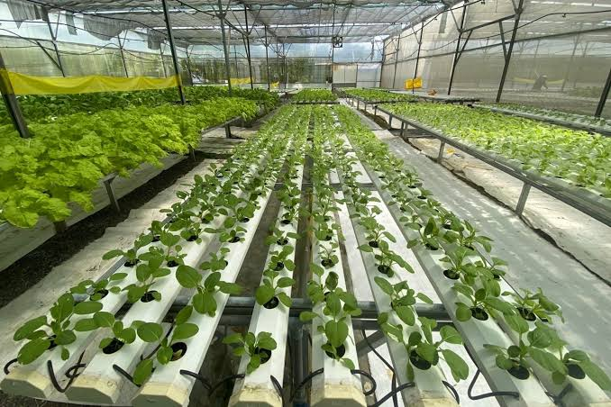

# Phần 1. Phân tích Chỉ ra ít nhất 3 lỗi cú pháp trong đoạn mã trên và giải thích tại sao kết quả render không như ý.
- Lỗi 1: Dùng # từ h1 xuống h3 khiến tiêu đề không theo thứ tự lúc to lúc nhỏ làm cho tiêu đề bị xấu đi
- Lỗi 2: Lỗi định dạng Logo dự án: trước  phải có dấu ! để định dạng được đây là hình ảnh
- Lỗi 3: Lỗi định dạng: Tiêu đề quan trọng thì nên để in đậm tức là dùng dấu **, nhưng trong bài lại dùng dấu * nên thành in nghiêng
## Phần 2: Hoàn thiện Viết lại đoạn mã chuẩn để hiển thị: 1 ảnh Logo, tiêu đề phân cấp H1 -&gt; H2, và một câu in đậm đúng quy tắc.
# Lợi ích của rau sạch
- Bảo vệ sức khỏe và phòng ngừa bệnh tật
- Giá trị dinh dưỡng cao
- Tốt cho hệ tiêu hóa
- An toàn cho trẻ và người già
- Bảo vệ  môi trường trong lành
## Danh sách cái loại rau 

### Lưu ý quan trọng
**Việc bổ sung rau mỗi ngày là điều cần thiết của cơ thể vì rau chứa rất nhiều chất dinh dưỡng cho cơ thể nên bạn hãy bổ sung vào  mâm cơm nhà mình 1 đĩa rau nhé😍**
